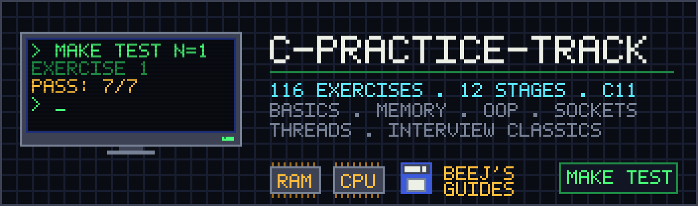

# c-practice-track



116 small, self-paced C exercises with a test suite, taking you from basic
syntax to memory management, object-oriented C, data structures, POSIX
networking and threads — the ground that C/C++ developer interviews actually
cover.

The structure follows [LilTaiga/50-small-c-exercises](https://github.com/LilTaiga/50-small-c-exercises):
one `.md` per exercise explaining the contract, one `.c` file you implement,
one command to test it. The curriculum follows two books you should read
alongside it:

- [Beej's Guide to C Programming](https://beej.us/guide/bgc/html/split/) (BGC)
- [Beej's Guide to Network Programming](https://beej.us/guide/bgnet/html/split-wide/index.html) (BGNET)

Every exercise links the chapter it draws from. Read the chapter, then do the
exercise, then move on. Nothing here requires anything outside the C standard
library and POSIX.

## Requirements

- A C11 compiler (`gcc` or `clang`)
- `make`
- Linux or macOS (stages 10–11 use POSIX sockets and pthreads)

## How to work with this repo

Exercises live in [`exercises/`](./exercises/). Each one has an `NNN.md`
with the problem statement and examples, and an `NNN.c` with a stub for you to
fill in. The `.c` also has a `main` under `#ifndef EXERCISE_TEST` that you can
use as a playground before running the real tests.

```bash
make run N=1             # run the playground main in exercises/001.c
make test N=1            # run the tests for exercise 1
make test N=1 SANITIZE=1 # same, with AddressSanitizer + UBSan (find leaks and UB)
make test-all            # one PASS/FAIL line per exercise
make check               # type-check every exercise and test without running them
make test N=1 SOLUTION=1 # run the tests against the reference solution instead
```

Add `V=1` to any command to see the full compiler invocation.

Reference solutions live in [`solutions/`](./solutions/). They exist so you can
compare approaches after you have a passing implementation of your own, and so
the test suite can be verified independently of your code. Reading a solution
before attempting the exercise defeats the purpose.

`lib.c` / `lib.h` are yours: once you have implemented something you want to
reuse in later exercises (say, `my_strlen` or `send_all`), **move** the
definition into `lib.c`, declare it in `lib.h`, and it is linked into every
exercise from then on. Each exercise is otherwise compiled on its own, so an
exercise cannot see another exercise's `.c` file.

> [!TIP]
> Do the exercises without reading the `.md` first if you are feeling bold —
> the function name and prototype in `include/exercises.h` are often enough.

## Index

See [`exercises/README.md`](./exercises/README.md) for the full list, and
[`docs/roadmap.md`](./docs/roadmap.md) for how the stages map to the two
guides and to the questions that come up in C/C++ interviews.

[](docs/roadmap.md)

|  | Stage | Topic                                   | Exercises |
| -- | ----- | --------------------------------------- | --------- |
|  | 1     | Foundations                             | 001–010   |
|  | 2     | Pointers and arrays                     | 011–020   |
|  | 3     | Strings                                 | 021–032   |
|  | 4     | Structs, enums, unions, bit-fields      | 033–040   |
|  | 5     | Memory                                  | 041–050   |
|  | 6     | Bits and bytes                          | 051–060   |
|  | 7     | Object-oriented C                       | 061–068   |
|  | 8     | Data structures                         | 069–079   |
|  | 9     | Environment and toolchain               | 080–088   |
|  | 10    | Networking                              | 089–102   |
|  | 11    | Concurrency                             | 103–107   |
|  | 12    | Interview classics                      | 108–116   |

## Suggested pace

One stage a week is comfortable alongside a job. Stages 1–3 can go faster if
you have written C before; stages 5, 7 and 10 deserve the full week.

## Adding exercises

The conventions are written down in [`docs/authoring.md`](./docs/authoring.md).
Add the prototype to `include/exercises.h`, write the four files, bump `LAST`
in the `Makefile`, and add a row to the index.

## Credits

Repo structure and test-harness idea: [LilTaiga/50-small-c-exercises](https://github.com/LilTaiga/50-small-c-exercises).
Curriculum: Brian "Beej Jorgensen" Hall's guides, which are free to read online.
