# Roadmap: stages, chapters, interview questions

How each stage maps to the two guides, and which recurring C/C++ interview
questions it prepares you for. Chapter links go to the split HTML editions.

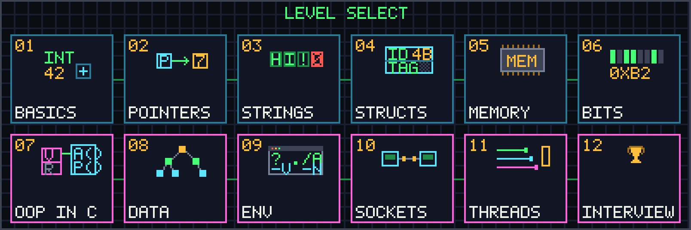

## 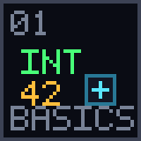 Stage 1 — Foundations (001–010)

Read: BGC [2 Hello, World!](https://beej.us/guide/bgc/html/split/hello-world.html),
[3 Variables and Statements](https://beej.us/guide/bgc/html/split/variables-and-statements.html),
[4 Functions](https://beej.us/guide/bgc/html/split/functions.html),
[14 Types II](https://beej.us/guide/bgc/html/split/types-ii-way-more-types.html).

Interview ground: integer promotion, signed overflow is undefined behaviour,
`unsigned` wraparound, `bool` in C, why `int` has no fixed size.

## 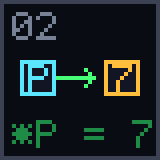 Stage 2 — Pointers and arrays (011–020)

Read: BGC [5 Pointers](https://beej.us/guide/bgc/html/split/pointers.html),
[6 Arrays](https://beej.us/guide/bgc/html/split/arrays.html),
[11 Pointers II: Arithmetic](https://beej.us/guide/bgc/html/split/pointers2.html),
[23 Pointers III](https://beej.us/guide/bgc/html/split/pointers-iii-pointers-to-pointers-and-more.html).

Interview ground: array/pointer decay, pointer arithmetic in elements not
bytes, `ptrdiff_t` vs `size_t`, passing arrays to functions, row-major layout,
function pointers, pointers to pointers.

## 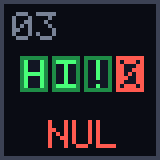 Stage 3 — Strings (021–032)

Read: BGC [7 Strings](https://beej.us/guide/bgc/html/split/strings.html),
[15 Types III: Conversions](https://beej.us/guide/bgc/html/split/types-iii-conversions.html),
[21 Characters and Strings II](https://beej.us/guide/bgc/html/split/characters-and-strings-ii.html).

Interview ground: "implement strlen/strcpy/strcmp/strstr", NUL termination,
buffer sizes vs lengths, `atoi` overflow, in-place algorithms.

## 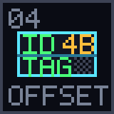 Stage 4 — Structs, enums, unions, bit-fields (033–040)

Read: BGC [8 Structs](https://beej.us/guide/bgc/html/split/structs.html),
[10 typedef](https://beej.us/guide/bgc/html/split/typedef-making-new-types.html),
[20 structs II](https://beej.us/guide/bgc/html/split/structs-ii-more-fun-with-structs.html),
[22 enum](https://beej.us/guide/bgc/html/split/enumerated-types-enum.html).

Interview ground: struct padding and alignment, `offsetof` / `container_of`,
type punning through unions vs `memcpy`, bit-field portability, flexible
array members, pass-by-value cost.

## 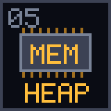 Stage 5 — Memory (041–050)

Read: BGC [12 Manual Memory Allocation](https://beej.us/guide/bgc/html/split/manual-memory-allocation.html),
[16 Qualifiers and Specifiers](https://beej.us/guide/bgc/html/split/types-iv-qualifiers-and-specifiers.html),
[35 Incomplete Types](https://beej.us/guide/bgc/html/split/incomplete-types.html).

Interview ground: ownership conventions, `realloc` growth policies, arena vs
pool allocators, multiplication overflow in allocation sizes, alignment,
leaks and double frees (run everything here with `SANITIZE=1`).

## 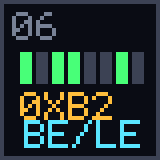 Stage 6 — Bits and bytes (051–060)

Read: BGC [24 Bitwise Operations](https://beej.us/guide/bgc/html/split/bitwise-operations.html),
[37 Fixed Width Integer Types](https://beej.us/guide/bgc/html/split/fixed-width-integer-types.html);
BGNET [3.2 Byte Order](https://beej.us/guide/bgnet/html/split-wide/ip-addresses-structs-and-data-munging.html),
[7.5 Serialization](https://beej.us/guide/bgnet/html/split-wide/slightly-advanced-techniques.html).

Interview ground: popcount, power-of-two tricks, endianness, why you cannot
cast a `char *` to `uint32_t *`, serialization without `struct` dumps,
checksums.

## 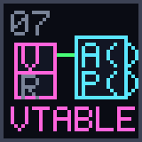 Stage 7 — Object-oriented C (061–068)

Read: BGC [20.7 Fake OOP](https://beej.us/guide/bgc/html/split/structs-ii-more-fun-with-structs.html),
[23.7 Pointers to Functions](https://beej.us/guide/bgc/html/split/pointers-iii-pointers-to-pointers-and-more.html),
[35 Incomplete Types](https://beej.us/guide/bgc/html/split/incomplete-types.html),
[32.2 Generic Selections](https://beej.us/guide/bgc/html/split/types-part-v-compound-literals-and-generic-selections.html).

Interview ground: "how do you do encapsulation / polymorphism / inheritance /
generics in C?" — opaque types, vtables, first-member embedding, `void *`
with element size and comparators, callbacks with context, `_Generic`.
This is also what the C++ compiler does for you under the hood.

## 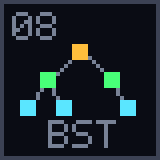 Stage 8 — Data structures (069–079)

No single chapter; apply stages 5 and 7.

Interview ground: stack, ring-buffer queue, linked list (reverse, cycle,
merge), hash map with chaining, BST, heap, LRU cache. These come up in nearly
every C/C++ screening.

## 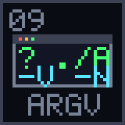 Stage 9 — Environment and toolchain (080–088)

Read: BGC [9 File Input/Output](https://beej.us/guide/bgc/html/split/file-inputoutput.html),
[17 Multifile Projects](https://beej.us/guide/bgc/html/split/multifile-projects.html),
[18 The Outside Environment](https://beej.us/guide/bgc/html/split/the-outside-environment.html),
[19 The C Preprocessor](https://beej.us/guide/bgc/html/split/the-c-preprocessor.html),
[25 Variadic Functions](https://beej.us/guide/bgc/html/split/variadic-functions.html),
[28 Exiting a Program](https://beej.us/guide/bgc/html/split/exiting-a-program.html),
[31 goto](https://beej.us/guide/bgc/html/split/goto.html).

Interview ground: `argv` parsing, `FILE *` and `EOF`, binary I/O pitfalls,
`va_list`, macro double-evaluation, error-code conventions, `goto cleanup`.

## 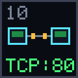 Stage 10 — Networking (089–102)

Read: BGNET [2 What is a socket?](https://beej.us/guide/bgnet/html/split-wide/what-is-a-socket.html),
[3 IP Addresses, structs, and Data Munging](https://beej.us/guide/bgnet/html/split-wide/ip-addresses-structs-and-data-munging.html),
[5 System Calls or Bust](https://beej.us/guide/bgnet/html/split-wide/system-calls-or-bust.html),
[6 Client-Server Background](https://beej.us/guide/bgnet/html/split-wide/client-server-background.html),
[7 Slightly Advanced Techniques](https://beej.us/guide/bgnet/html/split-wide/slightly-advanced-techniques.html).

Interview ground: TCP vs UDP, `struct sockaddr` family, `getaddrinfo`, the
`socket/bind/listen/accept` sequence, partial sends, framing messages on a
stream, `poll`/`select`, parsing protocol text safely.

## 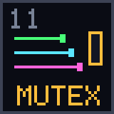 Stage 11 — Concurrency (103–107)

Read: BGC [39 Multithreading](https://beej.us/guide/bgc/html/split/multithreading.html),
[40 Atomics](https://beej.us/guide/bgc/html/split/chapter-atomics.html).
The guide uses C11 `<threads.h>`; the exercises use POSIX `pthread`, which
is what production code and job descriptions use.

Interview ground: data races, mutexes, condition variables and spurious
wakeups, producer/consumer, atomics vs locks, one-time initialization.

##  Stage 12 — Interview classics (108–116)

Applies everything. Two sum, balanced brackets, reverse words, longest common
prefix, merge, quickselect, `strtok_r`, big-integer addition, RPN evaluation.

## What is deliberately not here

Signals, `setjmp`/`longjmp`, locale, wide characters and VLAs are covered in
BGC and are worth reading, but they are rarely asked and awkward to test in
isolation. C++-only material (classes, templates, RAII, the STL) is out of
scope; what is here is the C substrate that C++ interviews assume you know.
